# Insurance Company · Auto platform core

Two modules: underwriting (mock company records → rated quote → instant demo policy) and photo-assisted claims (upload → vision adapter → repair estimate → coverage/payout rules → simulated settlement). No npm dependencies or build step. Node 22+.

## Run

```sh
node insurance/server.mjs
# Open http://127.0.0.1:4188/insurance/
node --test tests/insurance.test.mjs
node --test tests/*.test.mjs
```

GitHub Pages can display the workspace but cannot execute Node APIs. Run the server above for the interactive flow. The original document-preparation app stays at the repository root on Pages.

The company database is seeded with `customer-1` / `vehicle-1` (Toyota Corolla). All records, image bytes, reservations and idempotency entries live in memory and reset on restart. All money is integer **satang**, currency THB (100 satang = 1 baht); UI displays baht. Tax, rates, prices and coverage rules are illustrative, not insurer tariffs or legal/tax guidance.

## API

All mutations require JSON and an `Idempotency-Key` of 8–128 letters/digits/underscore/hyphen. Retry the identical request with the same key. Conflicting payloads return 409. POST action endpoints accept `{}`. Optional `API_AUTH_TOKEN` requires `Authorization: Bearer …` on API calls except health. The local UI accepts that token in memory only. IDs are returned by preceding requests.

| Method | Endpoint | Input / result |
|---|---|---|
| GET | `/api/health` | Readiness and simulated-payment flag |
| GET | `/api/company` | Insurance Company, customers, vehicles, supported coverage, execution modes |
| POST | `/api/quotes` | `{customerId, vehicleId, coverage, sumInsured, deductible}` → quote, premium breakdown, 24-hour expiry |
| GET | `/api/quotes/:id` | Quote snapshot |
| POST | `/api/quotes/:id/issue` | Instant 365-day demo policy; repeat issuance returns the same policy |
| GET | `/api/policies/:id` | Policy and coverage terms |
| POST | `/api/claims` | `{policyId, occurredAt, cause, photos}` → submitted claim |
| GET | `/api/claims/:id` | Claim, assessment, receipt; excludes raw photo bytes |
| POST | `/api/claims/:id/assess` | Vision, priced damage, deductible, remaining aggregate limit, eligibility |
| POST | `/api/claims/:id/settle` | Approved claim → idempotent mock payment receipt |

Example quote body:

```json
{"customerId":"customer-1","vehicleId":"vehicle-1","coverage":"comprehensive","sumInsured":60000000,"deductible":500000}
```

This yields net 1,296,000 + tax 90,720 = 1,386,720 satang. Quote generation uses sum insured × coverage basis points × vehicle age factor × deductible factor, subject to a minimum. Quote terms are copied into the issued policy; callers cannot supply premium or payout amounts.

Claims accept ISO timestamps with timezone, cause `collision` or `other`, and 1–6 `{mimeType, data}` photos. `data` is raw base64 without a data-URL prefix. JPEG/PNG/WebP only, at most 2 MiB each, at most 18 MiB total JSON body. Signatures and duplicate hashes are checked; full image decoding belongs in the vision gateway. Reusing a photo on the same policy or submitting the same incident timestamp returns 409. These are demo duplicate checks, not fraud detection.

## Data flow

```mermaid
flowchart LR
  A[Underwriting workbench] --> B[Mock Insurance Company DB]
  B --> C[Versioned deterministic rating]
  C --> D[Quote: 24-hour validity]
  D --> E[Instant demo policy]
  E --> F[Claim + accident photos]
  F --> G[Validate and hash photos]
  G --> H[Mock, local Ollama or HTTP gateway]
  H --> I[Validate structured observations]
  I --> J[Parts table + labor estimate]
  J --> K[Coverage + deductible + available limit]
  K --> L{Automation checks}
  L -->|pass| M[Approved: reserve payout]
  L -->|exception| N[Review required]
  M --> O[Idempotent simulated settlement]
```



## Vision and settlement boundaries

Default **MockVision does not analyze image content**. It always returns one moderate bumper-damage scenario, marked `simulated: true` in API and UI. No model is downloaded, no external service is called, and no funds move. This makes the end-to-end core reproducible without credentials.

For actual image analysis, the built-in **OllamaVision** calls a locally installed vision model. Install Ollama and pull your chosen image-capable model separately, then run:

```sh
VISION_PROVIDER=ollama OLLAMA_MODEL=your-installed-vision-model node insurance/server.mjs
```

It sends base64 images to local `/api/chat`, requests schema-constrained JSON with temperature 0 and a 512-token output cap, and times out after 120 seconds. No customer identity, registration or insurance prices enter the model prompt. Model confidence is self-reported and uncalibrated; actual image accuracy/hardware performance require evaluation on representative labeled accident photos. No model is installed or downloaded by this app. API contract follows [Ollama vision](https://docs.ollama.com/capabilities/vision) and [structured outputs](https://docs.ollama.com/capabilities/structured-outputs).

Alternatively, supply your own gateway via `VISION_URL` and optional server-side `VISION_TOKEN`. HTTPS is required except localhost. The adapter sends `{claimId, vehicle:{make,model}, photos:[{mimeType,data}]}` with a 30-second timeout. Configure the gateway to return JSON:

```json
{"provider":"your-provider","model":"your-image-model","simulated":false,"confidence":0.96,"vehicleVisible":true,"structuralDamage":false,"damages":[{"part":"bumper","severity":"moderate"}]}
```

Parts: `bumper`, `door`, `hood`, `fender`, `headlamp`, `windshield`; severities: `minor`, `moderate`, `severe`. Aggregate multiple photos into one finding per part to avoid double charging; lower confidence for unsupported parts or uncertain observations. Unsupported/duplicate parts or malformed responses fail assessment without approving a claim. Prices come exclusively from the server's versioned table, never model-generated monetary amounts. Never put gateway tokens in browser code.

Repair = sum(parts baseline × severity factor + 25% labor). Payout = max(0, min(repair − deductible, remaining aggregate policy limit)). Approved claims reserve that amount; settled claims continue consuming the limit. Under concurrent assessments, per-policy locks prevent over-reservation. A low-confidence result (<0.85), missing evidence, structural damage, possible total loss (repair ≥75% of sum insured), unconfirmed coverage, exhausted limit, or payout >50,000 THB requires review and cannot settle automatically. Review processing is intentionally outside this core; do not label it settled. Vision failure keeps the claim submitted and retryable.

All policies and payments remain simulated even when a real vision gateway is configured. No premium collection or real payment rail is included. Mock payment receipts are keyed by claim ID. Automated processing covers eligible cases; this prototype does not establish that photos can replace inspection for every accident.

## Deployment seams

- `domain.mjs`: pure rating, upload/schema validation, repair and payout rules.
- `adapters.mjs`: mock DB, vision gateway, mock payments.
- `service.mjs`: lifecycle, snapshots, idempotency and serialized reservations.
- `server.mjs`: bounded JSON API, localhost-only binding, static workspace.
- `ui.js` / `ui.css`: dependency-free responsive workbench.

Before an external deployment, replace in-memory collections with a transactional repository: unique quote→policy and incident keys; persisted idempotency and claim→payment IDs; row locks for aggregate reservations; outbox/reconciliation for payment retries. This demo's locks are process-local and its payment adapter explicitly accepts simulated receipts only. Add authenticated users, ownership/role checks, upload/object-storage policies, quotas, retention and audit events. `API_AUTH_TOKEN` is a shared demo gate, not multi-user authorization. Store images privately rather than in a public static directory. Real settlement needs a separately implemented payment adapter and a verified payment state machine.

## Efficient changes

Search symbols before reading files, keep diffs focused, reuse these adapters, and test relevant behavior. Use `node --test tests/insurance.test.mjs` for this module and broaden to the existing suite when integration changes affect the original app. Do not re-download models or scan compiled bundles for isolated core changes.
